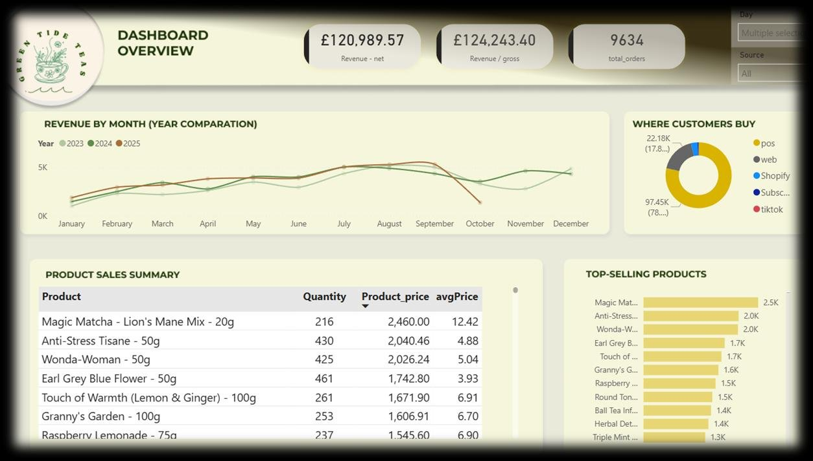

# 🍵 Green Tide Teas – Sales Dashboard (Power BI)

A Power BI dashboard for a small independent tea shop on the Cornish coast. It turns three years of sales, product and customer data into clear answers for the owner: what sells, when it sells, where customers buy and who comes back.

> The data is anonymised and aggregated, inspired by a real small business in Cornwall, UK. It is used for portfolio purposes only.

## 🎯 Business questions

- **Products:** Which teas sell best, and which ones underperform?
- **Customers:** How many customers are new, and how many come back?
- **Seasonality:** Which months and categories bring in the most sales?
- **Sales channels:** How does in-store (POS) compare with online (web, Shopify, subscriptions, TikTok)?

## 🛠 What I did

1. **Cleaned and transformed** raw Shopify and customer data in Power Query: handled missing values, merged sources and removed duplicates.
2. **Built a data model** with one-to-many relationships between Orders and Customers.
3. **Wrote DAX measures** for the KPIs: total revenue (net and gross), total orders, average order value, new vs returning customers and top products.
4. **Designed interactive visuals** with filters by day and sales source, a year-on-year revenue comparison and product rankings.

## 💡 Key insights

- Most revenue comes from **in-store (POS) sales**. Online channels are small, so there is room to grow them.
- Sales **peak from July to September**, which helps with stock planning before the summer season.
- A few teas (for example *Magic Matcha*, *Anti-Stress Tisane* and *Earl Grey Blue Flower*) bring in a large share of revenue. These are good products to feature in marketing.

## 📄 Full project overview

👉 [Read the full project overview (PDF)](Green_Tide_Teas_Project_Overview.pdf)

## 🧰 Tools

Power BI · Power Query · DAX · Data modelling
